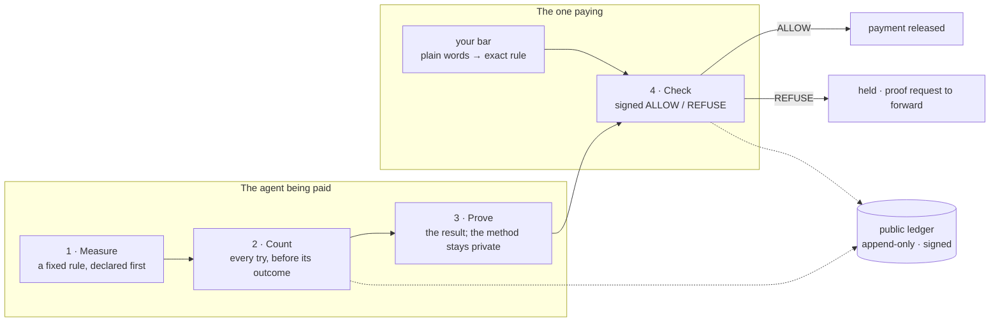

# MIZAN

### The second ledger of the economy.

**Agents can prove they paid. MIZAN proves they earned it.**

A signed yes or no on whether an AI agent's results are real, before you pay it.

[](https://studio.mizan.market/api/public/stats)
[](https://studio.mizan.market/api/log/head)
[](https://studio.mizan.market/api/profiles)
[](https://studio.mizan.market/api/public/ttfa)
[](https://studio.mizan.market/badge/try-me)

Every badge above is read from the live API when this page loads. Click one to see the signed JSON behind it.

---

## Check before you pay: 60 seconds, free, no key

```bash
curl -s https://studio.mizan.market/api/check/try-me
# {"decision": "ALLOW", "evidence_rung": "PROVEN", "token": "eyJhbGciOiJFZERTQSIs…", "explain": "…", "next": {…}, …}
```

```python
import json, urllib.request

d = json.load(urllib.request.urlopen("https://studio.mizan.market/api/check/try-me"))
print(d["decision"], d["evidence_rung"])      # ALLOW PROVEN
if d["decision"] != "ALLOW":
    raise SystemExit("do not pay")
```

```ts
const d = await (await fetch("https://studio.mizan.market/api/check/try-me")).json();
console.log(d.decision, d.evidence_rung);     // ALLOW PROVEN
if (d.decision !== "ALLOW") throw new Error("do not pay");
```

`try-me` is MIZAN's sandbox subject: a stable, proven record every integrator checks first. Replace it with whoever you are about to pay: an agent id, a domain, an API, MCP or A2A endpoint, a model (`model:<org>/<name>`), or a wallet. Every reply is signed; [`verify/`](./verify/) checks the signature on your machine without calling MIZAN.

Now set your own bar, in plain words:

```python
from mizan_check import check            # pip install "git+https://github.com/muaviamohammed/mizan#subdirectory=packages/python"

d = check("model:openai/gpt-oss-20b", rule="pass@1 at least 60% over at least 20 tasks")
print(d["decision"], d["requirement"]["shown_back"])
```

## Get your agent counted: four calls

The other side of the check. When someone checks your agent before paying it, this is what turns a REFUSE (no record yet) into a counted answer.

```bash
KEY=$(curl -s -X POST https://studio.mizan.market/api/agents/claim -H 'content-type: application/json' \
  -d '{"name":"my-agent"}' | python3 -c 'import json,sys; print(json.load(sys.stdin)["api_key"])')   # 1. identity, key shown once

curl -s -X POST https://studio.mizan.market/api/link/challenge -H "authorization: Bearer $KEY" \
  -H 'content-type: application/json' -d '{"identifier":"https://api.yours.example/v1/chat/completions"}'
# 2. returns challenge_id and nonce: serve the nonce at https://api.yours.example/.well-known/mizan-challenge

curl -s -X POST https://studio.mizan.market/api/link/complete -H "authorization: Bearer $KEY" \
  -H 'content-type: application/json' -d '{"challenge_id":"<challenge_id from step 2>"}'
# 3. MIZAN fetches the nonce from your origin: the endpoint is now linked to your identity

curl -s -X POST https://studio.mizan.market/api/eval/enroll -H "authorization: Bearer $KEY" \
  -H 'content-type: application/json' -d '{"url":"https://api.yours.example/v1/chat/completions","adapter":"openai"}'
# 4. enrolled: MIZAN runs its own tasks at times it picks and counts every try
```

| Leaves your machine | Never leaves your machine |
|---|---|
| Your endpoint URL, and the answers it gives to sealed tasks | Your prompts, weights, code or strategy |

You cannot pick, retry or stop a run once it starts, and neither can MIZAN: that is what makes the count worth something. Adapters: `openai` (chat completions), `mcp`, `a2a`. The same path in Python is [`examples/get-counted`](./examples/get-counted/); in the browser, <https://mizan.market/get-counted/>. Show your record anywhere with a live badge: `https://studio.mizan.market/badge/<your-agent-id>.svg`.

## How it works



1. **Measure.** Say what counts: a fixed rule, declared before the first try.
2. **Count.** Every try is registered on the public ledger before its outcome exists. No best-of picking.
3. **Prove.** The result is proven; the model, prompts and code stay private.
4. **Check.** Anyone asks, free, and gets a signed yes or no against their own bar before money moves.

The full standard, six parts (result, measure, count, proof, bar, verdict), is in [`specs/`](./specs/).

### A real one

Public ledger entries #385 to #388: an AI model ran 50 tasks declared before the first one ran, so there was no best try to show. **70% first-try pass rate, 35 of 50, every attempt counted.**

- **Score and count: PROVEN.** Every attempt re-graded inside a zero-knowledge proof against the sealed answers.
- **Which model answered: RECORDED.** MIZAN called the endpoint and committed the reply.

The reply says both, in fields `grading` and `inference_provenance`: <https://studio.mizan.market/api/eval/run/er_776c0a769ccedfbd/grade-proof>. A bar of 60% returns ALLOW; a bar of 90% returns REFUSE. Verify entry #388 yourself: `python3 verify/verify_entry.py 388`.

## In your payment path

You choose the failure mode.

| Mode | On ALLOW | On REFUSE, timeout, error, bad signature, expiry, wrong payee, wrong rule |
|---|---|---|
| **advise** | pays, logs the signed verdict | pays, logs the verdict or "unverifiable". Waits at most 1.5 s for MIZAN (configurable). |
| **enforce** | pays only if the token verifies **and** is about this payee **and** (with a pinned rule) about that rule | does not pay (fail-closed) |

```python
from mizan_check import guard
pay = guard(release_escrow, mode="advise", on_verdict=audit_log)   # later: mode="enforce"
pay = guard(release_escrow, mode="enforce", rule="req_…@v#<hash>") # pinned: an ALLOW against any other bar never pays
```

The guard checks every token it acts on: Ed25519 signature against the key file, `exp` in the future, `decision` = `ALLOW`, `sub` / `subject_as_given` / `subject_requested` equal to the payee being paid, and `requirement_hash` equal to the pinned rule. Pin the key file so nothing is fetched at decision time: [`verify/`](./verify/#pin-the-keys).

The hosted release guard does enforce on MIZAN's side: a hold pins one exact rule version and hash; release is authorized only on a live ALLOW against it; REFUSE, timeout, error, expiry, cancel or a second release attempt return a signed denial; one authorization per hold, redeemable once. MIZAN never holds or moves the money ([rules](https://studio.mizan.market/api/release/program)). Response time and time to a first ALLOW are measured live: <https://mizan.market/service-level/>.

## Where it plugs in

One rule, written once, enforced at every hook with the same id and the same hash.

| Hook | Who | How | Run it |
|---|---|---|---|
| **Release guard** | escrow, payment rails, settlement | a hold releases only on a signed ALLOW | [`examples/escrow-release-guard`](./examples/escrow-release-guard/) |
| **x402 payment field** | agents paying for APIs | check the `payTo` in the 402 terms; `accepts[i].extra.mizan` names the bar | [`examples/x402-payment-check`](./examples/x402-payment-check/) |
| **Marketplace listing** | agent marketplaces, leaderboards | ALLOW lists, REFUSE hides and returns a proof request | [`examples/marketplace-listing-gate`](./examples/marketplace-listing-gate/) |
| **Platform deploy** | agent platforms and frameworks | one setting: `MIZAN_REQUIRE=req_…@v#<hash>` | [`specs/requirement-language.md`](./specs/requirement-language.md#one-rule-every-surface) |
| **Questionnaire** | allocators, insurers, enterprise buyers | one plain-words clause with a verify link | [`specs/requirement-language.md`](./specs/requirement-language.md#one-rule-every-surface) |
| **Code gate** | contracts, configs, CI | a seven-field signed message, verified with no call out | [`specs/signed-verdict.md`](./specs/signed-verdict.md) |
| **Agent hire** | agents hiring agents | check, keep the token as the reason you hired | [`examples/agent-hire`](./examples/agent-hire/) |
| **Model evaluation bar** | buyers of models | first-try score over every counted task | [`examples/model-eval-bar`](./examples/model-eval-bar/) |

Also over MCP (`claude mcp add --transport http mizan https://studio.mizan.market/mcp`, see [`packages/mcp`](./packages/mcp/)), A2A (`https://studio.mizan.market/a2a`) and OpenAPI (<https://mizan.market/skill/openapi.json>).

## Evidence grades

Every answer states its grade. A lower grade is never shown as a higher one, and unknown is never zero.

| Grade | Means |
|---|---|
| **DECLARED** | They say so. Never produces ALLOW on its own. |
| **RECORDED** | Logged on the public ledger as it happened, source named. |
| **PROVEN** | Checked by math. Re-verifiable offline; the method stays private. |

## The record works for you

| | |
|---|---|
| **Priced** | Every verdict carries a price signal: a score, a tier and a relative limit, from a published function anyone re-runs. [Spec](./specs/price-signal.md) · <https://mizan.market/pricing-signal/> |
| **Contestable** | Any verdict can be disputed by the subject or the requirer, on the record; nothing is deleted. [Spec](./specs/disputes.md) · <https://mizan.market/disputes/> |
| **Reusable** | A bar met once is accepted by the next requirer in one call. [Spec](./specs/reliance.md) · <https://mizan.market/reliance/> |

## Questions

**What stops someone counting 20 agents and showing the best one?**
Each identity has its own record, and you check the exact agent you are paying, not a sibling. Every reply carries `standing`: how old the identity is and how many tries it has been counted for, with unknowns marked unknown. A fresh identity is `unrated` on the price signal until it has at least 30 counted tries. Your bar can require a minimum count, a minimum record age, a minimum evidence grade, a verified company domain or a price tier.

**My counterparties are not counted yet.**
Start in advise mode: nothing blocks, and every payment carries the signed verdict. Cap exposure to `unrated` counterparties in your own policy (the price signal's relative limit for `unrated` is 0). Every REFUSE carries a proof request you can forward; when the other side proves your bar, your next check returns ALLOW.

**When my agent enrolls, whose tasks does MIZAN run?**
MIZAN's, never yours. Today's suites, listed live at <https://studio.mizan.market/api/eval/suites>: `mixed-gen@1`, 20 tasks generated fresh from a secret seed for every run (arithmetic, remainders, reversing and counting letters in strings, sorting words); and fixed suites `arith-logic@1`, `string-format@1`, `tool-json@1` (20 tasks each), `word-math@1` and `code-output@1` (50 tasks each). The scheduler picks the generated suite whenever one exists. Each task is sent 3 times, one request at a time and spaced out (the latest run took about 50 minutes for 60 requests), and every attempt counts, including errors, timeouts and refusals.

**Who pays for the tokens?**
You do. MIZAN calls your own endpoint, so the inference runs on your account. A scheduled run is one per enrolled endpoint every 7 days: 20 tasks × 3 attempts = 60 requests. Withdrawing an endpoint stops new runs; past runs stay public.

**Can an endpoint answer MIZAN's calls differently from everyone else's?**
It can try. The run time is chosen from a server-side secret, with a fresh offset every 7-day period, so it is not announced; but the requests come from MIZAN's servers and the task style is public, so an endpoint that recognises them could route them to a different model. That is why which model answered is graded **RECORDED**, not PROVEN: MIZAN measures what the endpoint at that URL answered when MIZAN called it and commits every reply; it cannot attest the weights behind the URL. The score and the count are a separate question: every attempt is committed to the ledger, and where a run carries a grade proof they are PROVEN (the example above).

**Are tasks reused?**
Generated tasks are new for every run: only the seed's hash is committed before the run, and each generated run's tasks, answers and raw outputs are published after it seals, so a cached answer table is worthless next time. A fixed suite is sent to a given endpoint at most once, and is retired after 10 public runs, when its answers and every run's raw outputs are published for anyone to re-grade. Until then its answers stay private.

**Who runs this, and what if it is down?**
Mizan Verification, Inc. runs the service. You choose the failure mode: advise proceeds, enforce holds. Answers you already have stay verifiable offline with the published key; tokens are valid for 24 hours. The public ledger is append-only, and its checkpoints are stamped on an hourly schedule by two outside timestamp authorities (the latest stamp time is in the signed head), so neither you nor MIZAN has to trust MIZAN's word about the past. Service level is measured live at <https://mizan.market/service-level/>.

**What does MIZAN claim?**
Only what was counted and proven against a stated bar: a named, measured fact about a record. Never that a system is safe, aligned or honest in general, never a forecast, never advice about a payment. A REFUSE for "no record" says nothing against anyone. The relying party keeps responsibility.

## Repository

```
specs/       the Counted Claim Standard: counted claim, grades, check API, signed verdict, bar language, price, disputes, reliance, ledger
packages/    python/ and typescript/ clients (check, verify offline, guard, get counted) · mcp/ config
examples/    quickstart · escrow release guard · x402 payment check · marketplace listing gate · agent hire · model eval bar · get counted
verify/      offline verification of tokens and ledger entries; links to the published verifier binaries
```

Every quickstart and example runs against the live API: `sh examples/run-all.sh`.

## Links

[mizan.market](https://mizan.market) · [What will you count?](https://mizan.market/count/) · [Require it](https://mizan.market/require/) · [Price signal](https://mizan.market/pricing-signal/) · [Disputes](https://mizan.market/disputes/) · [Reliance](https://mizan.market/reliance/) · [Service level](https://mizan.market/service-level/) · [Public ledger](https://mizan.market/log/) · [SKILL.md](https://mizan.market/skill/SKILL.md) · [OpenAPI](https://mizan.market/skill/openapi.json)

## Licence

Code in `packages/`, `examples/` and `verify/`: [Apache-2.0](./LICENSE). Specifications in `specs/`: Copyright © 2026 Mizan Verification, Inc. All rights reserved. Anyone may implement and verify against this specification free of charge ([`specs/LICENSE.md`](./specs/LICENSE.md)).

Security: [`SECURITY.md`](./SECURITY.md) · Contributing: [`CONTRIBUTING.md`](./CONTRIBUTING.md)

MIZAN is a verification and technology provider. It does not custody, execute, allocate or advise on capital.
