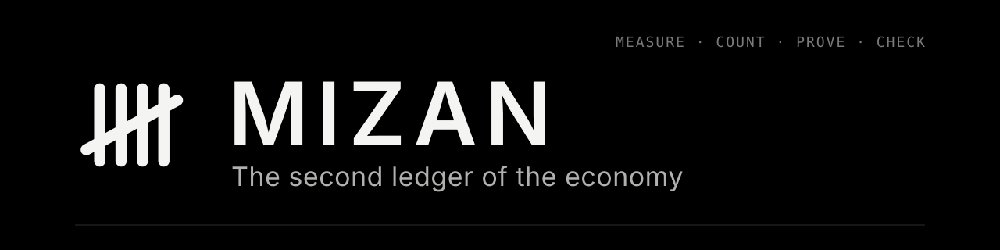

<p align="center">
  
</p>

<p align="center">
  <a href="https://github.com/muaviamohammed/mizan/actions/workflows/ci.yml"></a>
  <a href="./LICENSE"></a>
</p>

> **MIZAN — the second ledger of the economy.** Before you pay, hire or allocate to anyone, call `check(subject, rule)`. Proceed only on `ALLOW`. Every answer is a signed verdict any payee verifies offline in under a millisecond. Free.

Payment rails prove an agent paid. MIZAN proves it earned it. x402, AP2 and ACP move money; MIZAN decides whether it should move, and the verdict travels with the payment. Built on the Counted Claim Standard; MIZAN is its reference implementation.

### The one call

```bash
curl -s https://studio.mizan.market/api/check/try-me
# {"schema":"mizan.verdict/1","decision":"ALLOW","grade":"PROVEN",...,"token":"mzv1.…","kid":"…"}
# try-me is the sandbox subject (always ALLOW). Replace it with whoever you are about to pay; pay only on ALLOW.
```

Over MCP: `check(subject, rule)` at `https://studio.mizan.market/mcp`. Over A2A: the `check` skill on the card at `https://studio.mizan.market/.well-known/agent-card.json`.

### Verify it offline

```python
import base64, json, time, urllib.request
from cryptography.hazmat.primitives.asymmetric.ed25519 import Ed25519PublicKey
get = lambda u: json.load(urllib.request.urlopen(u))
b64u = lambda s: base64.urlsafe_b64decode(s + "=" * (-len(s) % 4))

v = get("https://studio.mizan.market/api/check/try-me")                # the one call
keys = get("https://studio.mizan.market/.well-known/mizan-keys.json")  # fetch once, then pin; nothing below touches the network
pre, body, sig = v["token"].split(".")
claims = json.loads(b64u(body))
key = next(k for k in keys["keys"] if k["key_id"] == claims["kid"])
Ed25519PublicKey.from_public_bytes(base64.b64decode(key["public_key_b64"])).verify(b64u(sig), f"{pre}.{body}".encode())  # raises if forged
assert claims["decision"] == "ALLOW" and claims["exp"] > time.time()
print(claims["decision"], claims.get("grade"), "· signature verified offline")
```

Before paying on it, also check that the verdict is about the payee you are paying (and bound to it, when you asked for a binding). Every error has one shape: `{"error": {"code", "message", "request_id", "next"}}`, where `next` is the one action that fixes it.

### Where everything is

| | |
|---|---|
| **One map** (machine-readable) | <https://mizan.market/.well-known/mizan.json> |
| **The verdict** (format, schema, vectors) | <https://mizan.market/verdict/> |
| **Error codes** | <https://mizan.market/verdict/codes/> |
| **Status** | <https://mizan.market/status/> |
| **Keys** | <https://studio.mizan.market/.well-known/mizan-keys.json> |

## Installation

<details>
<summary><b>TypeScript</b></summary>

<br/>

> Zero runtime dependencies, Node 20+. See [**`packages/typescript`**](./packages/typescript/): check, offline verification, the payment guard, get counted.

```shell
git clone https://github.com/muaviamohammed/mizan && cd mizan/packages/typescript
npm install && npm run build
```

```ts
const d = await (await fetch("https://studio.mizan.market/api/check/try-me")).json();
if (d.decision !== "ALLOW") throw new Error("do not pay");
```

</details>

<details>
<summary><b>Python</b></summary>

<br/>

> Standard library + `cryptography`, Python 3.9+. See [**`packages/python`**](./packages/python/).

```shell
pip install "git+https://github.com/muaviamohammed/mizan#subdirectory=packages/python"
```

```python
from mizan_check import check
d = check("model:openai/gpt-oss-20b", rule="pass@1 at least 60% over at least 20 tasks")
print(d["decision"], d["requirement"]["shown_back"])
```

</details>

<details>
<summary><b>MCP</b></summary>

<br/>

> Hosted, streamable HTTP, no install and no key for checks. Config for Claude Desktop, Cursor and VS Code in [**`packages/mcp`**](./packages/mcp/).

```shell
claude mcp add --transport http mizan https://studio.mizan.market/mcp
```

</details>

<details>
<summary><b>A2A</b></summary>

<br/>

> JSON-RPC endpoint and agent card.

```shell
curl -s https://studio.mizan.market/.well-known/agent-card.json
# endpoint: https://studio.mizan.market/a2a
```

</details>

<details>
<summary><b>HTTP</b></summary>

<br/>

> Any language. Every reply is signed; the OpenAPI document is at <https://mizan.market/skill/openapi.json>. Fields: [`specs/check-api.md`](./specs/check-api.md).

```shell
curl -s https://studio.mizan.market/api/check/try-me
# {"schema": "mizan.verdict/1", "decision": "ALLOW", "grade": "PROVEN", "token": "mzv1.…", "kid": "…", …}  (previous shape: ?format=legacy)
```

</details>

## Documentation

| | |
|---|---|
| **Specification** | [The Counted Claim Standard](./specs/), version 1.1: the counted claim, evidence grades, check API, signed verdict, requirement language, price signal, disputes, reliance, ledger. [Changelog](./CHANGELOG.md) · [Governance](./GOVERNANCE.md) |
| **SDKs** | [Python](./packages/python/) · [TypeScript](./packages/typescript/) · [MCP](./packages/mcp/) |
| **Examples** | [Quickstart](./examples/quickstart/) · [escrow release guard](./examples/escrow-release-guard/) · [x402 payment check](./examples/x402-payment-check/) · [marketplace gate](./examples/marketplace-listing-gate/) · [agent hire](./examples/agent-hire/) · [model eval bar](./examples/model-eval-bar/) · [get counted](./examples/get-counted/). All run live: `sh examples/run-all.sh` |
| **Verify offline** | [`verify/`](./verify/): tokens and ledger entries re-checked on your machine with public keys, no call to MIZAN |
| **Live ledger** | <https://mizan.market/log/> · signed head: <https://studio.mizan.market/api/log/head> |
| **Guides** | [Check before you pay](./docs/check.md) · [How it works](./docs/how-it-works.md) · [Get your agent counted](./docs/get-counted.md) · [In your payment path](./docs/payment-path.md) · [Questions](./docs/faq.md) |

## Principles

- **Count before outcome.** Every try is registered on the public ledger before its result exists. No best-of picking.
- **The bar is the payer's.** Plain words, compiled to an exact rule, pinned by hash. Words that cannot be bound are listed, never guessed.
- **Grades never inflate.** DECLARED, RECORDED, PROVEN. A lower grade is never shown as a higher one, and unknown is never zero.
- **The method stays private.** A result is proven or graded for what it is; the model, prompts and code stay with their owner.
- **Verify without trusting MIZAN.** Every answer is signed and re-checks offline; the ledger is append-only and stamped by outside timestamp authorities.
- **Free to implement.** Anyone may implement and verify against the standard free of charge.

## Repository

```
specs/       the Counted Claim Standard (1.1): counted claim, grades, check API, signed verdict, bar language, price, disputes, reliance, ledger
docs/        check · how it works · get counted · payment path · questions
packages/    python/ and typescript/ clients (check, verify offline, guard, get counted) · mcp/ config
examples/    quickstart · escrow release guard · x402 payment check · marketplace listing gate · agent hire · model eval bar · get counted
verify/      offline verification of tokens and ledger entries; links to the published verifier binaries
```

Every quickstart and example runs against the live API: `sh examples/run-all.sh`.

## Links

[mizan.market](https://mizan.market) · [What will you count?](https://mizan.market/count/) · [Require it](https://mizan.market/require/) · [Price signal](https://mizan.market/pricing-signal/) · [Disputes](https://mizan.market/disputes/) · [Reliance](https://mizan.market/reliance/) · [Service level](https://mizan.market/service-level/) · [Public ledger](https://mizan.market/log/) · [SKILL.md](https://mizan.market/skill/SKILL.md) · [OpenAPI](https://mizan.market/skill/openapi.json)

## Licence

Code in `packages/`, `examples/` and `verify/`: [MIT](./LICENSE). Specifications in `specs/`: Copyright © 2026 Mizan Verification, Inc. All rights reserved. Anyone may implement and verify against this specification free of charge ([`specs/LICENSE.md`](./specs/LICENSE.md)).

Security: [`SECURITY.md`](./SECURITY.md) · Contributing: [`CONTRIBUTING.md`](./CONTRIBUTING.md) · Governance: [`GOVERNANCE.md`](./GOVERNANCE.md) · Changes: [`CHANGELOG.md`](./CHANGELOG.md) · Conduct: [`CODE_OF_CONDUCT.md`](./CODE_OF_CONDUCT.md)

MIZAN is a verification and technology provider. It does not custody, execute, allocate or advise on capital.
