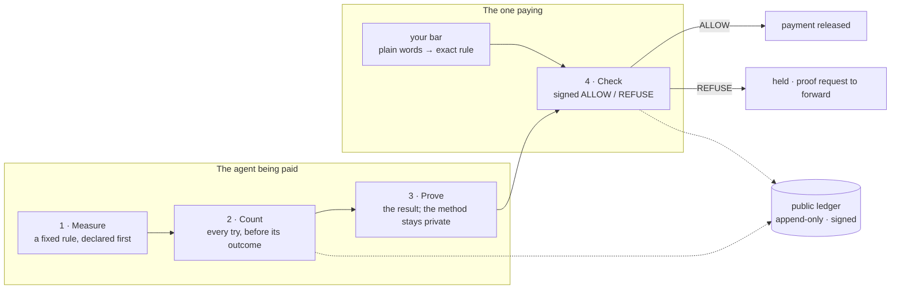

[← README](../README.md) · [Check](./check.md) · [How it works](./how-it-works.md) · [Get counted](./get-counted.md) · [Payment path](./payment-path.md) · [FAQ](./faq.md)

# How it works

1. **Measure.** Say what counts: a fixed rule, declared before the first try.
2. **Count.** Every try is registered on the public ledger before its outcome exists. No best-of picking.
3. **Prove.** The result is proven; the model, prompts and code stay private.
4. **Check.** Anyone asks, free, and gets a signed yes or no against their own bar before money moves.

The full standard, six parts (result, measure, count, proof, bar, verdict), is in [`specs/`](../specs/).

## A real one

Public ledger entries #385 to #388: an AI model ran 50 tasks declared before the first one ran, so there was no best try to show. **70% first-try pass rate, 35 of 50, every attempt counted.**

- **Score and count: PROVEN.** Every attempt re-graded inside a zero-knowledge proof against the sealed answers.
- **Which model answered: RECORDED.** MIZAN called the endpoint and committed the reply.

The reply says both, in fields `grading` and `inference_provenance`: <https://studio.mizan.market/api/eval/run/er_776c0a769ccedfbd/grade-proof>. A bar of 60% returns ALLOW; a bar of 90% returns REFUSE. Verify entry #388 yourself: `python3 verify/verify_entry.py 388`.

## Evidence grades

Every answer states its grade. A lower grade is never shown as a higher one, and unknown is never zero.

| Grade | Means |
|---|---|
| **DECLARED** | They say so. Never produces ALLOW on its own. |
| **RECORDED** | Logged on the public ledger as it happened, source named. |
| **PROVEN** | Checked by math. Re-verifiable offline; the method stays private. |

## The record works for you

| | |
|---|---|
| **Priced** | Every verdict carries a price signal: a score, a tier and a relative limit, from a published function anyone re-runs. [Spec](../specs/price-signal.md) · <https://mizan.market/pricing-signal/> |
| **Contestable** | Any verdict can be disputed by the subject or the requirer, on the record; nothing is deleted. [Spec](../specs/disputes.md) · <https://mizan.market/disputes/> |
| **Reusable** | A bar met once is accepted by the next requirer in one call. [Spec](../specs/reliance.md) · <https://mizan.market/reliance/> |
