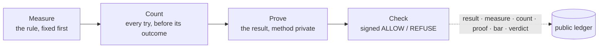

# The Counted Claim Standard

One shape for every result. A number travels with how it was measured, how many tries stand behind it, what evidence supports it, and whether it meets the bar of the party relying on it. MIZAN checks claims against this standard and signs the answer.

Live page: <https://mizan.market/counted-claim/> · Version 1 · November 2026.

## Documents

| Document | What it fixes |
|---|---|
| [`counted-claim.md`](./counted-claim.md) | The six parts of a counted claim: result, measure, count, proof, bar, verdict. The rules that bind them. |
| [`evidence-grades.md`](./evidence-grades.md) | DECLARED, RECORDED, PROVEN: what each grade means and what it can produce. |
| [`check-api.md`](./check-api.md) | The check: request, subjects, the reply fields an integrator relies on, errors. |
| [`signed-verdict.md`](./signed-verdict.md) | Every signed message (token, code-gate message, attestation, price message, signed replies) and how to verify each offline. |
| [`requirement-language.md`](./requirement-language.md) | The bar: plain words compiled to an exact rule, its hash, versioning, bindings, examples. |
| [`price-signal.md`](./price-signal.md) | The price signal beside every verdict: inputs, weights, tiers, the signed message. |
| [`disputes.md`](./disputes.md) | Contest and correction of a verdict, on the record. |
| [`reliance.md`](./reliance.md) | Delegated reliance: a bar met once, accepted by the next requirer in one call. |
| [`ledger.md`](./ledger.md) | The public ledger: Merkle log, signed heads, outside timestamps, verification. |

## Four steps, six parts

Measure, Count, Prove and Check produce the six parts. Every step lands on the [public ledger](./ledger.md), which nobody, MIZAN included, can rewrite.

## Conformance language

The key words MUST, MUST NOT, SHOULD and MAY are used as in RFC 2119. Where this text and a live reply from `https://studio.mizan.market` differ on a field name or value, the live reply and its OpenAPI document (<https://mizan.market/skill/openapi.json>) are authoritative, and the difference is a bug in this text: please [open an issue](../.github/ISSUE_TEMPLATE/spec.yml).

## Licence

Copyright © 2026 Mizan Verification, Inc. All rights reserved. Anyone may implement and verify against this specification free of charge. See [`LICENSE.md`](./LICENSE.md).
