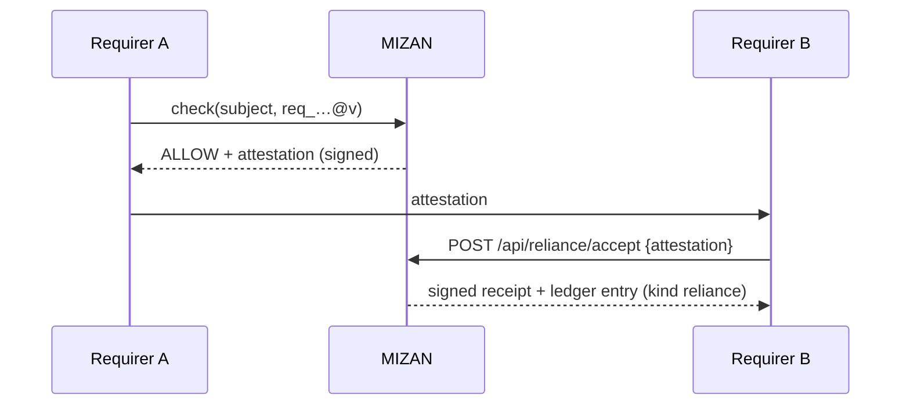

# Delegated reliance

> Part of [Counted 1.1](./README.md).

A bar met once is accepted everywhere it is trusted. When a record meets a requirer's published rule, the signed reply carries an attestation. A second requirer that trusts the same rule accepts it in one call instead of running its own check. The acceptance is written to the public ledger.

Live page: <https://mizan.market/reliance/>.

## The attestation

On an ALLOW against a published rule (`GET /api/check/{subject}?requirement=req_…@v&requirement_hash=…`) the reply carries:

```
attestation = { requirement, requirement_hash, subject, met: true, grade, check_id,
                issued, expires, key_id, sig, attestation_hash }
```

`sig` is Ed25519 over the canonical JSON of the nine fields (keys sorted, no spaces, ASCII), with the key named by `key_id` at <https://studio.mizan.market/.well-known/mizan-keys.json>. Anyone verifies it offline.

## Flow



MIZAN verifies the signature, the expiry and the rule hash, writes one ledger entry of kind `reliance` (`{first_requirer, relying_requirer, attestation_hash}`, hashes only), and returns `{accepted, attestation_hash, acceptance, log_index, proof, chain}`. `acceptance` is the code-gate message with the `attestation_hash` added and signed.

## Limits

- An attestation expires within 24 hours (`?attestation_ttl=<seconds>` shortens it) and never outlives the check it came from.
- A tampered, expired or self-issued attestation is refused with the reason; a rule's own author cannot accept its own.
- A requirer that wants a fresh answer simply checks again. Checking stays free.

## Calls

| Call | Use |
|---|---|
| `POST /api/reliance/accept {attestation, relying_requirer?, public?}` | Accept (your API key). |
| `GET /api/reliance/{subject}` | Who relies on a record: `chain {accepted, active, relying_requirers, first_requirers, rules, public, last_utc}`; names only where a requirer opted in. |

A relying requirer counts in the subject's `required_by` like any other while the attestation is live, and raises its [price signal](./price-signal.md).
